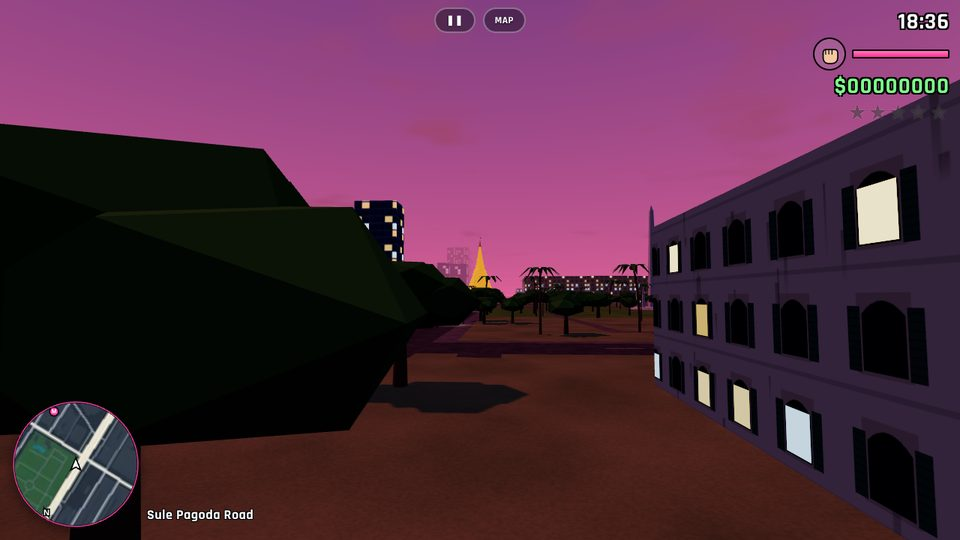
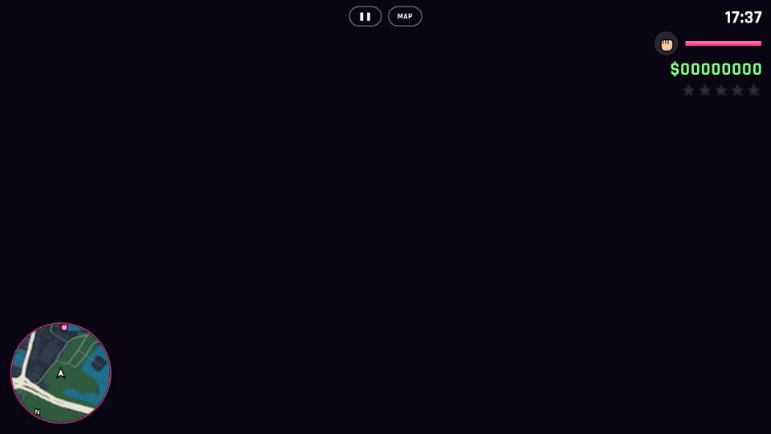
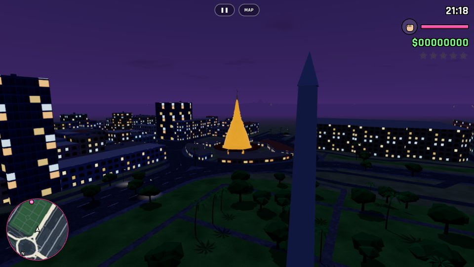
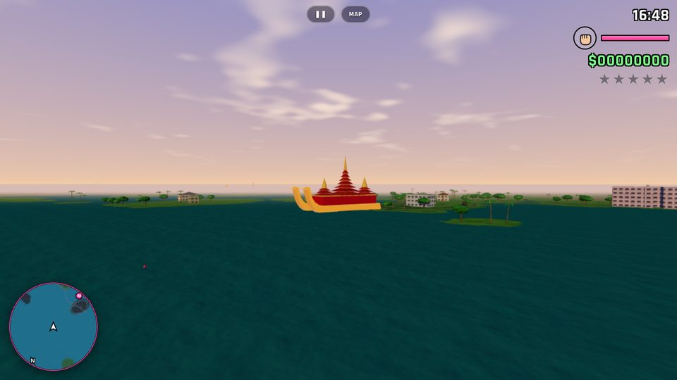

# Yangon Vice

An open-world 3D driving and crime-caper game for phones (and desktops), inspired by
80s-style open-world games, set on a **real map of Yangon, Myanmar**.

Every road, building footprint, lake, park and township boundary comes from
OpenStreetMap-derived data, so you can drive down Sule Pagoda Road, circle the Sule
roundabout, climb Singuttara Hill to the Shwedagon Pagoda, race around Kandawgyi Lake,
or cruise Pyay Road up to Inya Lake.

| Sunset on Sule Pagoda Road | Shwedagon on Singuttara Hill |
|---|---|
|  |  |
| **Sule Pagoda at night** | **Karaweik on Kandawgyi Lake** |
|  |  |

## Play

It's a static web app — no build step, no install.

```sh
python3 -m http.server 8000
# open http://localhost:8000 on your computer, or http://<your-ip>:8000 on your phone
```

Any static host works (GitHub Pages, Netlify, S3). Served over HTTPS it installs as an
app ("Add to Home Screen") and runs full-screen and offline.

### Controls

| | Touch | Keyboard |
|---|---|---|
| Move / steer | Left stick (push up = accelerate, pull down = reverse) | WASD / arrows |
| Look | Drag on the right side | Mouse drag |
| Enter / exit / carjack | **CAR** / **EXIT** | F |
| Gas / brake / handbrake | **GAS** / **BRAKE** / **DRIFT** | W / S / Space |
| Jump · sprint · punch | **JUMP** · **RUN** · **PUNCH** | Space · Shift · E |
| Horn · radio · camera | **HORN** · **RADIO** · **CAM** | H · R · C |
| Taxi job (in a taxi) | **TAXI** | T |
| Map (tap to set GPS) · pause | **MAP** · ❚❚ | M · Esc |

Gamepads are supported too.

### What's in the city

- **5 story missions** starting at real places: The Strand Hotel, Chinatown (19th Street),
  Botataung Pagoda, Karaweik (a street race around Kandawgyi Lake) and Hledan.
- **Taxi fares** to Yangon landmarks, 20 hidden **Golden Hintha** statuettes,
  **Shwe Spray** paint shops that lose the cops, health and armour pickups.
- **Wanted level** (5 stars), police pursuit with route-finding, getting busted or wasted
  (you can't swim, so keep out of the lakes and the Yangon River).
- **Traffic drives on the right**, as in Myanmar, but most cars are right-hand drive, so you
  climb out on the right. The traffic is what you actually see in Yangon: white Probox taxis
  with roof signs, 90s Mark II sedans, Hiace vans, Hilux "lain-ka" line-cars with benches and
  a canopy over the bed, YBS city buses and, on the downtown side streets, pedal-powered
  sai-ka trishaws. Cars line the kerbs, two wheels up on the pavement on the narrow streets.
  Bodies are smooth lofted shells (rounded noses and tails, tumblehome, wheel arches, a
  glasshouse with proper pillars) with reflective paint, chrome and alloy wheels, and tinted
  see-through windows: you can see the driver at the wheel, the seats and the dashboard inside.
  Trishaw riders pedal as they go.
- **Buildings** use a painted facade atlas: colonial stucco, 1960s–80s apartment blocks with
  balconies, laundry and AC units, glass towers, brick, and Chinatown shophouses. Ground floors
  facing a street are shops (signboards, half-open shutters, goods inside, lit at night);
  rooftops carry water tanks, stair huts and satellite dishes. The City Hall, the Secretariat,
  the High Court, Central Station and The Strand get their own heritage treatments.
- **Chinatown (Latha)**: between Lanmadaw Road and Latha Road every listed business is the real
  one, in its real place: about 300 shops, restaurants, gold shops, phone shops, hotels, banks
  and clinics from the Overture Maps places data, each on its own frontage with its real name
  on the signboard (Burmese, Chinese and English as listed) and a shopfront dressed for its
  trade: tea-shop stools, glowing gold-shop counters, garment rails, pharmacy crosses, hotel
  canopies. Upstairs clinics and schools hang banners on the first floor. Red lanterns, power
  lines, the 19th Street barbecue stalls and the Kheng Hock Keong and Kwan Yin temples too.
- **Divided roads** (Maha Bandula, Bogyoke Aung San, Strand, Pyay Road...) have a kerbed central
  island with black-and-yellow kerbs, a steel railing and double-arm street lamps, with gaps
  where side streets cross. It is solid, so cars can't drive through it.
- People with jointed bodies that walk, run and punch with bending knees and elbows, faces
  and a range of skin tones: men in longyi and flip-flops, women in htamein with thanaka on
  their cheeks and flowers in their hair, monks in maroon robes, khaki-uniformed police.
- A day–night cycle with neon sunsets, lit windows at night, and floodlit golden pagodas.
- Three procedurally generated radio stations (synthwave, electro, and a pentatonic chill station),
  plus engine, tyre, horn and siren sounds. All audio is synthesized, with no sound files.
- Districts announce themselves as you cross real township boundaries (Kyauktada, Pabedan,
  Bahan, Dagon, Kamaryut…) in English and Burmese.

### Performance

Built for mid-range phones: the city streams in 250 m tiles that are built in small time
slices, every tile is merged into a handful of draw calls, all cars and people are
GPU-instanced (with lighter models in the distance), and resolution adapts to keep the frame
rate up. Quality presets
(Low / Medium / High) are in Settings; phones default to Medium.

## Map data pipeline

`data/yangon.json` (roads, road graph, buildings, water, parks, trees, districts) and
`data/radar.webp` (minimap) are generated from [Overture Maps](https://overturemaps.org)
(OpenStreetMap and Microsoft ML building footprints):

```sh
pip install pyarrow shapely numpy pillow
python tools/fetch_overture.py tools/raw        # downloads only the Yangon bounding box
python tools/build_map.py tools/raw data/yangon.json
pip install python-myanmar myanmartools          # Zawgyi -> Unicode for Burmese shop names
python tools/build_shops.py tools/raw data/shops.json
```

World units are metres with the origin at Sule Pagoda (+x east, +z south). Building heights
come from OSM where tagged and are otherwise estimated from footprint size and district.

## Code layout

```
index.html, css/style.css    UI shell, HUD, touch controls, menus
src/main.js                  game loop and wiring
src/world/                   terrain, tile streaming, landmarks, sky, collision
src/vehicles/                car models, instanced renderer, arcade physics
src/humans/                  people models + instanced renderer
src/facades.js               procedural facade atlas and shop-sign textures
src/world/shops.js           real Chinatown shopfronts; src/world/medians.js road dividers
src/ai/                      road graph + A*, traffic, parked cars, pedestrians, police
src/missions.js              missions, taxi fares, collectibles, pickups
src/audio.js                 synthesized engine, SFX and radio
tools/                       map data pipeline
vendor/three.module.min.js   three.js r160 (MIT)
```

## Credits

- Map data © [OpenStreetMap](https://www.openstreetmap.org/copyright) contributors (ODbL),
  via Overture Maps Foundation; building footprints include Microsoft ML Buildings.
  The derived `data/` files are therefore available under the ODbL.
- 3D engine: [three.js](https://threejs.org) (MIT).
- This is a fan-made homage and is not affiliated with any game publisher.
